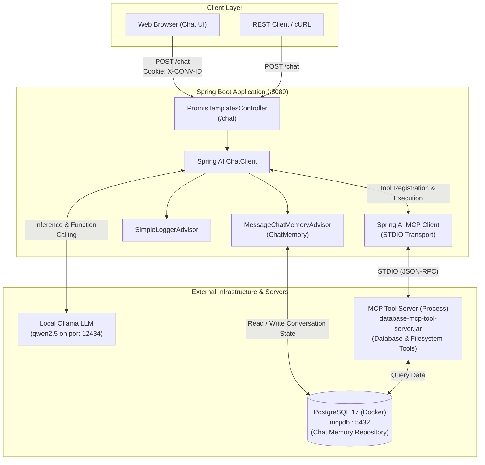

# Database MCP Tool Client

[](https://openjdk.org/)
[](https://spring.io/projects/spring-boot)
[](https://spring.io/projects/spring-ai)
[-purple.svg)](https://ollama.ai/)
[](https://www.docker.com/)
[](https://modelcontextprotocol.io/)

A modern, intelligent AI client application built with **Spring Boot** and **Spring AI**, implementing Anthropic's **Model Context Protocol (MCP)** via standard I/O (STDIO) transport.

This client integrates a local Large Language Model (run via **Ollama**) with external tool servers (such as a database and filesystem MCP server), enabling the AI to autonomously query PostgreSQL databases, read/write structured files, maintain persistent conversation state, and interact with users through a clean web UI or REST API.

---

## Table of Contents

- [Overview](#overview)
- [Architecture](#architecture)
- [Key Features](#key-features)
- [Tech Stack](#tech-stack)
- [Project Structure](#project-structure)
- [Prerequisites](#prerequisites)
- [Configuration](#configuration)
- [Getting Started](#getting-started)
- [API Reference](#api-reference)
- [Web Interface](#web-interface)
- [Sample Data](#sample-data)
- [Troubleshooting](#troubleshooting)

---

## Overview

The **Database MCP Tool Client** serves as the user-facing AI orchestrator in an MCP ecosystem:

1. **User Interaction**: Accepts natural language prompts through an interactive Web Chat UI or a REST endpoint (`POST /chat`).
2. **Context & Memory**: Maintains multi-turn conversation memory backed by a PostgreSQL database using Spring AI JDBC Chat Memory and HTTP session cookies (`X-CONV-ID`).
3. **Reasoning & Tool Invocation**: Delegates language understanding to a local LLM via Ollama (`qwen2.5:0.5B-F16` / `qwen2.5:1.5b`), equipped with tools exposed dynamically by the MCP Server.
4. **MCP Communication**: Spawns and interacts with external tool servers over STDIO using `spring-ai-starter-mcp-client` configured through `mcp.json`.

---

## Architecture



---

## Key Features

- **Model Context Protocol (MCP) Client**: Full STDIO MCP client integration using Spring AI (`spring-ai-starter-mcp-client`), allowing dynamic tool calling and server capability negotiation.
- **Local LLM Powered by Ollama**: Fully local AI execution without third-party API dependencies or fees, using Qwen 2.5 models (`qwen2.5:0.5B-F16` / `qwen2.5:1.5b`).
- **Persistent JDBC Chat Memory**: Multi-turn conversational memory persisted to PostgreSQL using `spring-ai-starter-model-chat-memory-repository-jdbc`. Schema initialization is fully automated (`spring.ai.chat.memory.repository.jdbc.initialize-schema=always`).
- **Session-Based Multi-Turn Context**: Uses HTTP cookies (`X-CONV-ID`) with automatic UUID assignment to separate user sessions while retaining history.
- **Zero-Config Docker Compose Integration**: Leverages `spring-boot-docker-compose` to automatically manage the PostgreSQL container lifecycle when launching the application.
- **Interactive Web Chat UI**: Built with Bootstrap 5.3, custom responsive CSS, dynamic auto-resizing input textarea, keyboard shortcuts (Enter to send), and a visual online indicator.
- **Apple Silicon Optimization**: Includes `netty-resolver-dns-native-macos (osx-aarch_64)` for native macOS DNS resolution.

---

## Tech Stack

| Component | Technology | Version / Details |
|---|---|---|
| **Language** | Java | 25 |
| **Framework** | Spring Boot | 4.1.1 |
| **AI Integration** | Spring AI | 2.0.1 |
| **LLM Provider** | Ollama (`spring-ai-starter-model-ollama`) | Local instance (Qwen 2.5) |
| **MCP Client** | Spring AI MCP Client (`spring-ai-starter-mcp-client`) | STDIO Transport |
| **Chat Memory** | JDBC Chat Memory Repository (`PostgreSQL`) | Automatic schema generation |
| **Database** | PostgreSQL | 17-alpine (via Docker Compose) |
| **Frontend** | HTML5, Bootstrap 5.3, Vanilla CSS, jQuery | Embedded Chat UI |
| **Build Tool** | Apache Maven | Maven 3.9+ |

---

## Project Structure

```text
database-mcp-tool-client/
├── compose.yml                               # Docker Compose definition for PostgreSQL 17
├── pom.xml                                   # Maven dependencies and build configuration
├── data/                                     # Sample datasets for AI and tool operations
│   ├── customers.json                        # Sample customer records (JSON)
│   └── input.txt                             # Sample text file explaining Java & MCP
├── src/
│   └── main/
│       ├── java/
│       │   └── com/mcp/client/
│       │       ├── MainDatabaseMCPTollClient.java     # Spring Boot application entry point
│       │       └── PromtsTemplatesController.java     # REST Controller (/chat) & ChatClient setup
│       └── resources/
│           ├── application.properties        # Main application properties & Ollama config
│           ├── application.yml               # Spring AI MCP client configuration
│           ├── mcp.json                      # MCP server process definition (command, jar, flags)
│           ├── prompts/                      # StringTemplate prompt files
│           │   ├── system-message.st         # Default system prompt
│           │   └── user-message-1.st         # Parameterized user query template
│           ├── static/                       # Static web resources
│           │   ├── robot.svg                 # ChatBot avatar graphic
│           │   └── styles.css                # Custom UI styling and chat bubbles
│           └── templates/
│               └── index.html                # Interactive ChatBot Web interface
└── README.md                                 # Project documentation
```

---

## Prerequisites

Before running the application, make sure you have the following installed:

1. **Java Development Kit (JDK) 25**
   ```bash
   java -version
   ```
2. **Docker Desktop / Docker Engine** (running and accessible)
   ```bash
   docker --version
   docker compose version
   ```
3. **Ollama** installed and running
   - Install from [ollama.com](https://ollama.com/)
   - Pull the designated model:
     ```bash
     ollama pull qwen2.5:0.5b
     # Or if using 1.5b:
     ollama pull qwen2.5:1.5b
     ```
   - Ensure Ollama is running at the port configured in `application.properties` (default is `http://localhost:11434`, project default is configured for `http://localhost:12434`).
4. **MCP Tool Server** (e.g., `database-mcp-tool`)
   - The server JAR referenced in `src/main/resources/mcp.json` must be built:
     ```bash
     # Example from sibling project directory:
     cd ../database-mcp-tool
     mvn clean package -DskipTests
     ```

---

## Configuration

### 1. `src/main/resources/application.properties`

```properties
spring.application.name=files-postgre-mcp-client
server.port=8089

# Ollama LLM Connection
spring.ai.ollama.base-url=http://localhost:12434
spring.ai.ollama.chat.options.model=qwen2.5:0.5B-F16
spring.ai.ollama.chat.options.temperature=1

# Chat Memory in PostgreSQL
spring.ai.chat.memory.repository.jdbc.initialize-schema=always
logging.level.org.springframework.ai.chat.client.advisor=debug

# MCP Client Config
spring.ai.mcp.client.stdio.server-configuration=classpath:mcp.json
```

> [!TIP]
> If your Ollama runs on the standard default port (`11434`), update `spring.ai.ollama.base-url=http://localhost:11434`.

### 2. `src/main/resources/mcp.json`

Specifies how the MCP client launches the target tool server via STDIO:

```json
{
  "mcpServers": {
    "database-mcp-tool": {
      "command": "java",
      "args": [
        "-jar",
        "/Users/rajesh/IdeaProjects/database-mcp-tool/target/database-mcp-tool-server-1.0.0-SNAPSHOT.jar",
        "--spring.profiles.active=stdio"
      ]
    }
  }
}
```

> [!IMPORTANT]
> Verify that the `-jar` path in `mcp.json` points to the valid absolute path of your built MCP Server JAR.

### 3. `compose.yml`

Defines the PostgreSQL instance used for conversation history and sample database operations:

```yaml
services:
  postgres:
    image: postgres:17-alpine
    environment:
      - POSTGRES_USER=postgres
      - POSTGRES_PASSWORD=postgres
      - POSTGRES_DB=mcpdb
    ports:
      - "5432:5432"
```

Spring Boot automatically launches this container on boot via `spring-boot-docker-compose`.

---

## Getting Started

### 1. Start Ollama and Download Model

```bash
# Pull model
ollama pull qwen2.5:0.5b

# Start Ollama (if not already running as a daemon)
ollama serve
```

### 2. Build the MCP Server

Ensure the companion MCP server is packaged:

```bash
cd /Users/rajesh/IdeaProjects/database-mcp-tool
mvn clean package -DskipTests
```

### 3. Build & Run the Client

Return to this project directory:

```bash
cd /Users/rajesh/IdeaProjects/database-mcp-tool-client
mvn spring-boot:run
```

Or open the project in **IntelliJ IDEA** and run `MainDatabaseMCPTollClient.java`.

When the application boots:
- Docker starts the PostgreSQL 17 container.
- JDBC tables for chat memory (`chat_memory`) are automatically created.
- The MCP Client launches the MCP Server subprocess via STDIO and discovers its tools.
- The HTTP server starts on port `8089`.

---

## API Reference

### Send Chat Message

Processes a user prompt through Spring AI, queries the LLM and MCP tools as required, and records the interaction in persistent chat memory.

- **URL**: `/chat`
- **Method**: `POST`
- **Headers**:
  - `Content-Type: application/json`
  - `Cookie: X-CONV-ID=<session-uuid>` *(Optional: omit on first request to auto-generate a new conversation ID)*

#### Request Body

```json
{
  "prompt": "List the top 5 customers from the database"
}
```

#### Response

- **Status**: `200 OK`
- **Set-Cookie**: `X-CONV-ID=<uuid>; Path=/; Max-Age=3600`
- **Body**:

```json
{
  "content": "Here are the top 5 active customers: 1. Amit Sharma (Berlin), 2. Priya Verma (Munich)..."
}
```

#### cURL Example

```bash
# Start a new conversation and save the session cookie
curl -i -X POST http://localhost:8089/chat \
  -H "Content-Type: application/json" \
  -c cookies.txt \
  -d '{"prompt": "Hello! What tools can you use?"}'

# Follow-up message reusing the conversation session
curl -i -X POST http://localhost:8089/chat \
  -H "Content-Type: application/json" \
  -b cookies.txt \
  -d '{"prompt": "Can you check customer records in Germany?"}'
```

---

## Web Interface

The project includes an embedded Web Chat interface located at `src/main/resources/templates/index.html`.

- **Access URL**: Open `http://localhost:8089/` in your browser.
- **Features**:
  - Clean message bubbles (Incoming vs. Outgoing).
  - Status indicator showing bot availability.
  - Automatic textarea expansion.
  - Sends messages asynchronously using AJAX to `/chat`.
  - Maintains conversation continuity via browser cookies.

---

## Sample Data

The `data/` directory contains sample resources for testing tool capabilities:

- **`data/customers.json`**: Customer entities containing ID, Name, Email, City, Country, and Active status.
- **`data/input.txt`**: Document discussing Java Spring Boot, Model Context Protocol, filesystem tools, and database security best practices.

---

## Troubleshooting

### 1. Connection Refused to Ollama (`localhost:12434` or `11434`)
- Check which port Ollama is listening on:
  ```bash
  lsof -i :11434
  lsof -i :12434
  ```
- If running on the standard port `11434`, update `spring.ai.ollama.base-url` in `src/main/resources/application.properties` to `http://localhost:11434`.

### 2. MCP Server Subprocess Fails to Start
- Verify the jar path specified in `src/main/resources/mcp.json` actually exists:
  ```bash
  ls -la /Users/rajesh/IdeaProjects/database-mcp-tool/target/database-mcp-tool-server-1.0.0-SNAPSHOT.jar
  ```
- If you have relocated or renamed the server jar, update the `args` array in `mcp.json`.

### 3. Docker Compose / PostgreSQL Errors
- Ensure Docker Desktop is active.
- If port `5432` is already in use by a local PostgreSQL installation, adjust the mapped port in `compose.yml` (e.g., `"5433:5432"`) and update your datasource configuration accordingly.

### 4. Apple Silicon Netty Resolver Issues
- If you see DNS resolution warnings on macOS Apple Silicon, ensure the `io.netty:netty-resolver-dns-native-macos` dependency with classifier `osx-aarch_64` remains present in `pom.xml`.

---

## License

This project is licensed under the Apache License 2.0.
